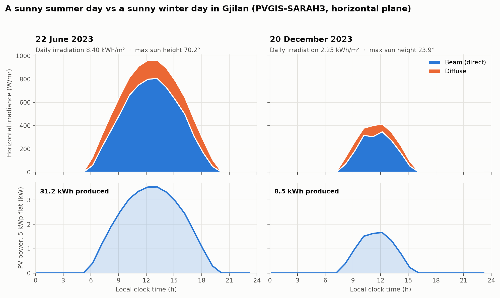
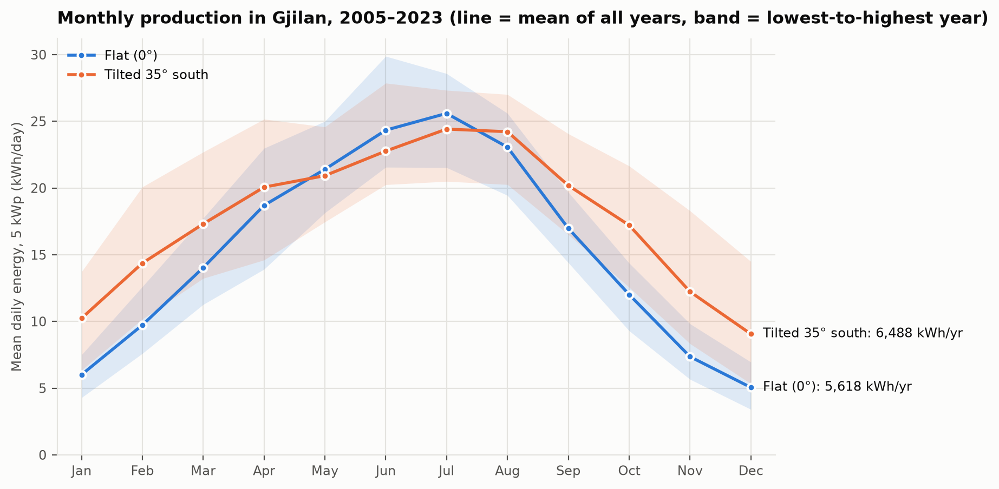
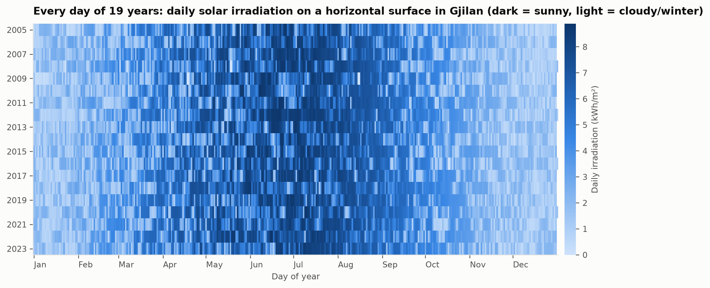

<!-- _class: title -->
<!-- _paginate: false -->

# Solar Energy Potential in Gjilan

### Applying Calculus and Machine Learning to Real Radiation Data

Gazmend Halili · MSc Control Systems and AI
Mathematics for Machine Learning · Dr. Sc. Ekrem Alimi
Public University "Kadri Zeka", Gjilan · HW1: project idea

---

## Why this project?

- Households in Gjilan considering **rooftop solar** need a concrete answer: is it worth it here?
- Installers quote numbers, but how much would a panel **really** produce here, and how should it be mounted?
- The question is answered with **real, hourly radiation data for Gjilan** and the **mathematics of this course**, implemented in Python.

<p class="muted">Location: 42.46° N, 21.47° E · time zone Europe/Belgrade (CET/CEST)</p>

---

## Main question

> **How much electricity would solar panels produce on a house in Gjilan, and how should they be installed to produce the most?**

Sub-questions:

1. How high is the sun over Gjilan at each hour and season?
2. When does the sun rise and set?
3. How many kWh does a 5 kWp system produce per day and per year?
4. At what angle (and direction) should the panels face?
5. Can daily production be predicted from the weather?
6. How often is it a "bad" solar day?

---

## Data sources: free, official, checked

| Source | What | Period |
|---|---|---|
| **PVGIS-SARAH3** (EU Joint Research Centre) | hourly beam + diffuse irradiance, sun height, modelled PV output | 2005–2023 |
| **PVGIS PVcalc** | official long-term yearly estimate, optimal tilt | reference |
| **Open-Meteo** (ERA5 reanalysis) | hourly temperature, cloud cover, humidity, wind | 2005–2023 |

- 19 years × 8,760 h = **166,536 hourly rows per source**
- Checked: **0 missing rows, 0 NaN**, physical limits OK, the two sources agree (r = 0.94)
- Found: **437 daylight hours (0.57 %)** where PVGIS stores missing satellite data as 0, not flagged by PVGIS; cleaned in v1.0
- Downloaded once and cached, so the analysis runs fully offline

<p class="muted">Caveat: PVGIS is derived from satellite images and validated against ground stations, not metered from a real panel.</p>

---

## Math plan: from the syllabus to the problem

| Sub-question | Math | Syllabus |
|---|---|---|
| Sun height over Gjilan | trigonometric functions (declination, hour angle, elevation) | wk 1 |
| Rate of change of power | derivatives, `dP/dt` | wk 4–5 |
| Sunrise and sunset | **Newton's method** on `sin α(t) = 0` | wk 6 |
| Angle sun–panel | vectors, dot product `cos θ = s · n` | (lin. alg.) |
| Daily / yearly kWh | **numerical integration** ∫P dt: trapezoid vs Simpson | wk 8–9 |
| Best tilt and direction | **optimization**, `dE/dβ = 0`, gradient | wk 7 |
| Predict from weather | least squares, normal equations `(XᵀX)β = Xᵀy`; random forest | (ML) |
| Bad solar days | probability, distributions | (prob.) |

All formulas are implemented by hand in NumPy; SciPy / scikit-learn are used only to **verify** them.

---

## Method pipeline

```
PVGIS + Open-Meteo  ─►  clean & align (UTC)  ─►  sun position (trig, Newton)
        │                                              │
        ▼                                              ▼
 validation vs PVGIS  ◄──  energy ∫P dt  ◄──  panel power (dot product)
                                │
                ┌───────────────┼────────────────┐
                ▼               ▼                ▼
         optimal tilt     regression model   bad-day probability
```

Every number in the final report is traceable to code and data.

---

## First result: one sunny day in summer vs winter



<p class="muted">Same 5 kWp flat system: <b>31.2 kWh</b> on 22 June vs <b>8.5 kWh</b> on 20 December. Sun height at noon ≈ 70° vs ≈ 24°.</p>

---

## First result: production across the year

<div class="cols">
<div>



</div>
<div class="side">

- 5 kWp flat: **5,618 kWh/yr**
- Tilted 35° south: **6,488 kWh/yr** (**+15.5 %**)
- PVGIS official (optimal 35°): **6,554 kWh/yr**, so we agree within ~1 %
- June–July: flat wins. Winter: tilt pays off. **Why?** The optimization will explain it.

</div>
</div>

---

## 19 years of data at a glance



<p class="muted">Each pixel = one day. Seasonal pattern + cloudy spells. The palest summer days (e.g. May 2008) are missing satellite data stored as 0, not clouds.</p>

---

## Plan: the homeworks are versions of one project

| Version | Week | Content |
|---|---|---|
| **HW1** idea | 5 | data downloaded and checked, first plots, math plan ✅ |
| **HW2** v1.0 | 6 | cleaning, sun geometry (trigonometry), Newton sunrise/sunset, derivatives |
| **HW3** v2.0 | 8 | sun vector, panel power, ∫P dt (trapezoid vs Simpson), validation vs PVGIS |
| **HW4** v3.0 | 9 | optimal tilt, regression (normal equations vs sklearn), probability |
| extras | 10–12 | tilt + azimuth optimization, temperature losses, payback in years |
| **Final** | 13 | notebook, report, slides |

Tools: Python 3.13 · NumPy · pandas · SciPy · matplotlib · scikit-learn · Jupyter

---

<!-- _paginate: false -->

# Thank you

### Questions?

<p class="muted">Code and data: project repository · all figures regenerate with <code>uv run python scripts/make_figures.py</code></p>
